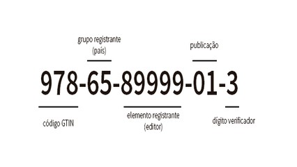

# Catálogo da biblioteca

## Contexto

O acervo de uma biblioteca escolar mantém o registro de seus livros catalogados por título, autor, ano de publicação e quantidade de páginas.

Crie uma `struct` para representar cada livro. O bibliotecário deseja listar todos os livros publicados a partir de determinado ano (`ano >= filtro_ano`). Caso nenhum livro cumpra o critério, uma mensagem informativa deve ser apresentada.

### Entrada

- A primeira linha contém um número inteiro `N`, a quantidade de livros no catálogo.
- As próximas `N` linhas contêm o título, autor, ano de publicação e quantidade de páginas de cada livro, separados por espaços.
- A última linha contém o ano limite para o filtro.

### Saída

- Para cada livro que satisfaz o critério (`ano >= filtro_ano`), imprima:
  `<titulo> - <autor> (<ano>, <paginas> pags)`
- Se nenhum livro for selecionado, imprima:
  `Nenhum livro encontrado`

## Restrições

- `1 <= N <= 50`
- Título e autor não contêm espaços e têm no máximo 50 caracteres cada.
- O ano e a quantidade de páginas são números inteiros positivos.

## Exemplos

<!-- tests tests.toml --limit 3 -->
<table><tr><th><code>Entrada</code></th><th><code>Saída</code></th></tr>
<!-- INPUT --><tr><td valign="top"><pre>
2
DomCasmurro Machado 1899 256
1984 Orwell 1949 328
1900
</pre></td>
<!-- OUTPUT --><td valign="top"><pre>
1984 - Orwell (1949, 328 pags)
</pre></td></tr>
<!-- INPUT --><tr><td valign="top"><pre>
2
DomCasmurro Machado 1899 256
1984 Orwell 1949 328
2000
</pre></td>
<!-- OUTPUT --><td valign="top"><pre>
Nenhum livro encontrado
</pre></td></tr>
<!-- INPUT --><tr><td valign="top"><pre>
3
HarryPotter Rowling 1997 223
SenhorDosAneis Tolkien 1954 1178
Duna Herbert 1965 680
1960
</pre></td>
<!-- OUTPUT --><td valign="top"><pre>
HarryPotter - Rowling (1997, 223 pags)
Duna - Herbert (1965, 680 pags)
</pre></td></tr>
</table>
<!-- end -->
