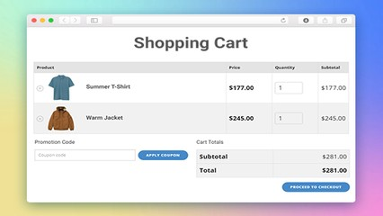

# Carrinho de compras

## Contexto

Em uma loja virtual, os produtos selecionados pelo cliente são armazenados em um carrinho com nome, preço unitário e quantidade adquirida. Antes de finalizar o pedido, o cliente pode informar um cupom de desconto.

Crie uma `struct` para representar cada item do carrinho. Calcule o subtotal dos produtos somando o valor de cada item (`preco * quantidade`). Em seguida, aplique o cupom informado:
- `DESC10`: concede 10% de desconto sobre o subtotal.
- `DESC20`: concede 20% de desconto sobre o subtotal.
- Qualquer outro código: nenhum desconto é aplicado.

Ao final, exiba o subtotal, o valor do desconto e o total a pagar.

### Entrada

- A primeira linha contém um inteiro `N`, a quantidade de itens no carrinho.
- As próximas `N` linhas contêm o nome do item (string sem espaços), o preço unitário (ponto flutuante) e a quantidade (inteiro).
- A última linha contém o código do cupom promocional (string).

### Saída

- Linha 1: `Subtotal: R$ <subtotal>`
- Linha 2: `Desconto: R$ <desconto>`
- Linha 3: `Total: R$ <total>` (todos formatados com duas casas decimais).

## Restrições

- `1 <= N <= 50`
- Preços são números positivos em ponto flutuante e quantidades são inteiros positivos.

## Exemplos

<!-- tests tests.toml --limit 3 -->
<table><tr><th><code>Entrada</code></th><th><code>Saída</code></th></tr>
<!-- INPUT --><tr><td valign="top"><pre>
1
Camiseta 50.00 2
DESC10
</pre></td>
<!-- OUTPUT --><td valign="top"><pre>
Subtotal: R$ 100.00
Desconto: R$ 10.00
Total: R$ 90.00
</pre></td></tr>
<!-- INPUT --><tr><td valign="top"><pre>
1
Camiseta 50.00 2
DESC20
</pre></td>
<!-- OUTPUT --><td valign="top"><pre>
Subtotal: R$ 100.00
Desconto: R$ 20.00
Total: R$ 80.00
</pre></td></tr>
<!-- INPUT --><tr><td valign="top"><pre>
2
Tenis 120.00 1
Meia 15.00 3
SEM_CUPOM
</pre></td>
<!-- OUTPUT --><td valign="top"><pre>
Subtotal: R$ 165.00
Desconto: R$ 0.00
Total: R$ 165.00
</pre></td></tr>
</table>
<!-- end -->
