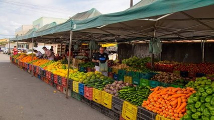

# Compras na feira

## Contexto

Na feira livre, pesquisar os preços antes de comprar é essencial para economizar. Uma pessoa deseja saber, a partir de uma quantia disponível em dinheiro, quantas unidades inteiras conseguiria comprar de cada fruta e qual seria o troco restante caso decidisse gastar seu orçamento exclusivamente naquela fruta.

Cada fruta possui um nome e um preço unitário. Utilize uma `struct` para armazenar as informações de cada fruta e processe a lista calculando a quantidade máxima adquirível e o troco resultante.

### Entrada

- A primeira linha contém um número inteiro `N`, representando a quantidade de frutas cadastradas.
- As próximas `N` linhas contêm o nome da fruta (string sem espaços) e seu preço unitário (ponto flutuante com duas casas decimais), separados por espaço.
- A última linha contém a quantia de dinheiro disponível (ponto flutuante com duas casas decimais).

### Saída

- Para cada fruta cadastrada, imprima uma linha no formato:
  `<nome>: <qtd> unidade(s) - Troco: R$ <troco>` (com o troco formatado com duas casas decimais).

## Restrições

- `1 <= N <= 50`
- Os preços e o dinheiro disponível são valores positivos em ponto flutuante.
- O nome da fruta não contém espaços e tem no máximo 30 caracteres.

## Exemplos

<!-- tests tests.toml --limit 3 -->
<table><tr><th><code>Entrada</code></th><th><code>Saída</code></th></tr>
<!-- INPUT --><tr><td valign="top"><pre>
1
Banana 2.00
10.00
</pre></td>
<!-- OUTPUT --><td valign="top"><pre>
Banana: 5 unidade(s) - Troco: R$ 0.00
</pre></td></tr>
<!-- INPUT --><tr><td valign="top"><pre>
1
Maca 3.00
10.00
</pre></td>
<!-- OUTPUT --><td valign="top"><pre>
Maca: 3 unidade(s) - Troco: R$ 1.00
</pre></td></tr>
<!-- INPUT --><tr><td valign="top"><pre>
1
Melancia 15.00
10.00
</pre></td>
<!-- OUTPUT --><td valign="top"><pre>
Melancia: 0 unidade(s) - Troco: R$ 10.00
</pre></td></tr>
</table>
<!-- end -->
