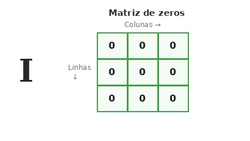

# Matriz de zeros

## Contexto

Ao trabalhar com matrizes, uma das operações mais comuns é inicializar uma estrutura bidimensional preenchida com valores padrão. Em muitas linguagens e algoritmos, costuma-se criar primeiro uma matriz composta inteiramente por zeros antes de preenchê-la com outros dados.

Dado o número de linhas `L` e o número de colunas `C`, crie uma matriz de dimensões `L` x `C` contendo apenas o número `0` em todas as suas posições e imprima-a na tela.

### Entrada

- A primeira linha contém dois números inteiros `L` e `C`, representando respectivamente a quantidade de linhas e colunas da matriz.

### Saída

- Imprima a matriz linha por linha. Cada linha deve ser exibida entre colchetes, com os elementos separados por espaços, no formato `[ 0 0 ... 0 ]`.

## Restrições

- `1 <= L <= 50`
- `1 <= C <= 50`

## Exemplos

<!-- tests tests.toml --limit 3 -->
<table><tr><th><code>Entrada</code></th><th><code>Saída</code></th></tr>
<!-- INPUT --><tr><td valign="top"><pre>
2 3
</pre></td>
<!-- OUTPUT --><td valign="top"><pre>
[ 0 0 0 ]
[ 0 0 0 ]
</pre></td></tr>
<!-- INPUT --><tr><td valign="top"><pre>
1 1
</pre></td>
<!-- OUTPUT --><td valign="top"><pre>
[ 0 ]
</pre></td></tr>
<!-- INPUT --><tr><td valign="top"><pre>
3 2
</pre></td>
<!-- OUTPUT --><td valign="top"><pre>
[ 0 0 ]
[ 0 0 ]
[ 0 0 ]
</pre></td></tr>
</table>
<!-- end -->
