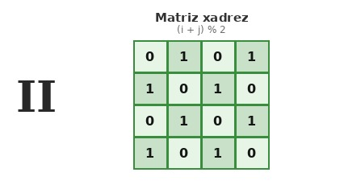

# Matriz xadrez

## Contexto

Em jogos de tabuleiro como damas e xadrez, as casas alternam entre duas cores ou estados. Na programação, podemos criar esse padrão utilizando os índices de linha e coluna de uma matriz.

Se considerarmos as coordenadas `(i, j)` com início em `0`, uma posição terá o valor `0` se a soma de seus índices `(i + j)` for par, e o valor `1` se a soma for ímpar. Dessa forma, a posição inicial `(0, 0)` sempre receberá `0`.

Dado o número de linhas `L` e o número de colunas `C`, construa e imprima a matriz com esse padrão xadrez.

### Entrada

- A primeira linha contém dois números inteiros `L` e `C`, representando respectivamente a quantidade de linhas e colunas da matriz.

### Saída

- Imprima a matriz gerada linha por linha. Cada linha deve ser exibida entre colchetes, com os elementos separados por espaços, no formato `[ 0 1 0 ... ]`.

## Restrições

- `1 <= L <= 50`
- `1 <= C <= 50`

## Exemplos

<!-- tests tests.toml --limit 3 -->
<table><tr><th><code>Entrada</code></th><th><code>Saída</code></th></tr>
<!-- INPUT --><tr><td valign="top"><pre>
3 3
</pre></td>
<!-- OUTPUT --><td valign="top"><pre>
[ 0 1 0 ]
[ 1 0 1 ]
[ 0 1 0 ]
</pre></td></tr>
<!-- INPUT --><tr><td valign="top"><pre>
2 4
</pre></td>
<!-- OUTPUT --><td valign="top"><pre>
[ 0 1 0 1 ]
[ 1 0 1 0 ]
</pre></td></tr>
<!-- INPUT --><tr><td valign="top"><pre>
1 1
</pre></td>
<!-- OUTPUT --><td valign="top"><pre>
[ 0 ]
</pre></td></tr>
</table>
<!-- end -->
