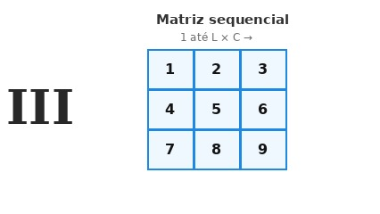

# Matriz sequencial

## Contexto

Numerar elementos em grade de forma sequencial é uma técnica comum em computação gráfica, mapeamento de memória e jogos de tabuleiro. Ao percorrer uma matriz de cima para baixo e da esquerda para a direita, podemos atribuir valores crescentes a cada posição.

Dado o número de linhas `L` e o número de colunas `C`, preencha uma matriz de dimensões `L` x `C` com inteiros consecutivos iniciando em `1` até `L * C`, percorrendo as linhas sequencialmente, e exiba a matriz resultante.

### Entrada

- A primeira linha contém dois números inteiros `L` e `C`, representando respectivamente a quantidade de linhas e colunas da matriz.

### Saída

- Imprima a matriz linha por linha. Cada linha deve ser exibida entre colchetes, com os elementos separados por espaços, no formato `[ 1 2 3 ... ]`.

## Restrições

- `1 <= L <= 50`
- `1 <= C <= 50`

## Exemplos

<!-- tests tests.toml --limit 3 -->
<table><tr><th><code>Entrada</code></th><th><code>Saída</code></th></tr>
<!-- INPUT --><tr><td valign="top"><pre>
2 3
</pre></td>
<!-- OUTPUT --><td valign="top"><pre>
[ 1 2 3 ]
[ 4 5 6 ]
</pre></td></tr>
<!-- INPUT --><tr><td valign="top"><pre>
3 2
</pre></td>
<!-- OUTPUT --><td valign="top"><pre>
[ 1 2 ]
[ 3 4 ]
[ 5 6 ]
</pre></td></tr>
<!-- INPUT --><tr><td valign="top"><pre>
1 4
</pre></td>
<!-- OUTPUT --><td valign="top"><pre>
[ 1 2 3 4 ]
</pre></td></tr>
</table>
<!-- end -->
