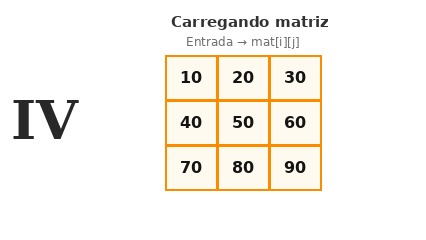

# Carregando matriz

## Contexto

Assim como aprendemos a ler vetores da entrada padrão, muitas aplicações exigem ler dados organizados em tabelas ou matrizes fornecidos pelo usuário.

Você receberá a quantidade de linhas `L` e a quantidade de colunas `C`, seguidas pelos `L * C` números inteiros que compõem a matriz. Seu programa deve ler todos os valores, armazená-los em uma matriz bidimensional e depois exibi-los linha por linha no formato padrão.

### Entrada

- A primeira linha contém dois números inteiros `L` e `C`, representando as dimensões da matriz.
- As próximas linhas contêm os `L * C` números inteiros que preenchem a matriz.

### Saída

- Imprima a matriz lida linha por linha. Cada linha deve ser exibida entre colchetes, com os elementos separados por espaços: `[ x1 x2 ... xC ]`.

## Restrições

- `1 <= L <= 50`
- `1 <= C <= 50`
- Cada elemento da matriz é um inteiro entre `-1000` e `1000`.

## Exemplos

<!-- tests tests.toml --limit 3 -->
<table><tr><th><code>Entrada</code></th><th><code>Saída</code></th></tr>
<!-- INPUT --><tr><td valign="top"><pre>
2 3
10 20 30
40 50 60
</pre></td>
<!-- OUTPUT --><td valign="top"><pre>
[ 10 20 30 ]
[ 40 50 60 ]
</pre></td></tr>
<!-- INPUT --><tr><td valign="top"><pre>
1 1
42
</pre></td>
<!-- OUTPUT --><td valign="top"><pre>
[ 42 ]
</pre></td></tr>
<!-- INPUT --><tr><td valign="top"><pre>
3 2
1 2
3 4
5 6
</pre></td>
<!-- OUTPUT --><td valign="top"><pre>
[ 1 2 ]
[ 3 4 ]
[ 5 6 ]
</pre></td></tr>
</table>
<!-- end -->
