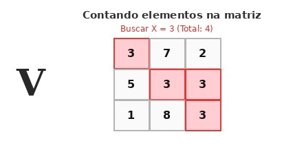

# Contando elementos na matriz

## Contexto

Depois de aprender a criar, preencher e ler matrizes, a próxima habilidade fundamental é navegar por suas células para buscar informações específicas.

Dada uma matriz de dimensões `L` x `C` e um número inteiro `X`, determine quantas vezes o valor `X` aparece dentro da matriz. Essa lógica de busca e contagem é a base para jogos de tabuleiro como o bingo, onde precisamos verificar a presença de números sorteados na cartela.

### Entrada

- A primeira linha contém dois números inteiros `L` e `C`, representando a quantidade de linhas e colunas da matriz.
- As próximas linhas contêm os `L * C` números inteiros que compõem a matriz.
- A última linha contém o número inteiro `X` a ser procurado.

### Saída

- Um número inteiro indicando a quantidade de ocorrências de `X` na matriz.

## Restrições

- `1 <= L <= 50`
- `1 <= C <= 50`
- Cada elemento da matriz e o valor `X` são inteiros entre `-1000` e `1000`.

## Exemplos

<!-- tests tests.toml --limit 3 -->
<table><tr><th><code>Entrada</code></th><th><code>Saída</code></th></tr>
<!-- INPUT --><tr><td valign="top"><pre>
2 2
5 3
3 7
3
</pre></td>
<!-- OUTPUT --><td valign="top"><pre>
2
</pre></td></tr>
<!-- INPUT --><tr><td valign="top"><pre>
2 2
5 3
3 7
9
</pre></td>
<!-- OUTPUT --><td valign="top"><pre>
0
</pre></td></tr>
<!-- INPUT --><tr><td valign="top"><pre>
3 3
1 2 1
4 1 6
1 8 1
1
</pre></td>
<!-- OUTPUT --><td valign="top"><pre>
5
</pre></td></tr>
</table>
<!-- end -->
