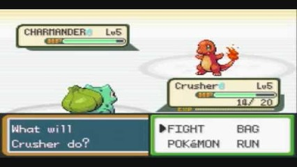

# Duelo Pokémon

## Contexto

Em uma arena Pokémon, dois treinadores colocam suas criaturas frente a frente em um combate por turnos simples. Cada criatura possui nome, ataque, defesa e pontos de vida (HP).

Crie uma `struct` para representar cada Pokémon. O duelo ocorre da seguinte forma:
1. O primeiro Pokémon ataca o segundo. O dano causado é `max(1, ataque1 - defesa2)`. O HP do defensor é reduzido por esse valor (mínimo de 0).
2. Se o segundo Pokémon ainda tiver HP maior que 0, ele contra-ataca com dano `max(1, ataque2 - defesa1)`, reduzindo o HP do primeiro.
3. Se em qualquer ataque o HP do defensor chegar a 0, a batalha é encerrada imediatamente.

### Entrada

- Linha 1: Dados do primeiro Pokémon: `nome`, `ataque`, `defesa` e `vida` (separados por espaço).
- Linha 2: Dados do segundo Pokémon: `nome`, `ataque`, `defesa` e `vida` (separados por espaço).

### Saída

- Para cada ataque executado, imprima:
  `<atacante> atacou <defensor> causando <dano> de dano!`
- Se o defensor for derrotado (HP = 0), imprima em seguida:
  `<defensor> foi derrotado!`
  `<atacante> venceu a batalha!`
- Se ambos sobreviverem ao turno, imprima:
  `Fim do turno: <p1> (HP <hp1>) vs <p2> (HP <hp2>)`

## Restrições

- Ataque, defesa e vida são números inteiros positivos.
- Os nomes não contêm espaços e têm no máximo 30 caracteres.

## Exemplos

<!-- tests tests.toml --limit 3 -->
<table><tr><th><code>Entrada</code></th><th><code>Saída</code></th></tr>
<!-- INPUT --><tr><td valign="top"><pre>
Pikachu 55 40 100
Charmander 52 43 100
</pre></td>
<!-- OUTPUT --><td valign="top"><pre>
Pikachu atacou Charmander causando 12 de dano!
Charmander atacou Pikachu causando 12 de dano!
Fim do turno: Pikachu (HP 88) vs Charmander (HP 88)
</pre></td></tr>
<!-- INPUT --><tr><td valign="top"><pre>
Gengar 80 30 20
Alakazam 85 20 50
</pre></td>
<!-- OUTPUT --><td valign="top"><pre>
Gengar atacou Alakazam causando 60 de dano!
Alakazam foi derrotado!
Gengar venceu a batalha!
</pre></td></tr>
<!-- INPUT --><tr><td valign="top"><pre>
Snorlax 30 100 150
Onix 20 120 100
</pre></td>
<!-- OUTPUT --><td valign="top"><pre>
Snorlax atacou Onix causando 1 de dano!
Onix atacou Snorlax causando 1 de dano!
Fim do turno: Snorlax (HP 149) vs Onix (HP 99)
</pre></td></tr>
</table>
<!-- end -->
