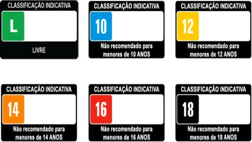

# Filtrando filmes

## Contexto

Uma plataforma de entretenimento deseja filtrar as opções de filmes exibidas no catálogo de acordo com a idade do usuário para respeitar o controle parental.

Cada filme possui classificação indicativa mínima (`0` para Livre, `10`, `12`, `14`, `16` ou `18`), duração em minutos e título. Utilize uma `struct` para representar cada filme. Seu programa deve exibir todos os filmes adequados à idade do usuário (`classificacao <= idade`) ou informar quando nenhuma opção estiver disponível.

### Entrada

- A primeira linha contém um número inteiro `N`, o total de filmes no catálogo.
- As próximas `N` linhas contêm a classificação indicativa, a duração em minutos e o título do filme (sem espaços), separados por espaços.
- A última linha contém a idade do usuário (número inteiro).

### Saída

- Para cada filme permitido para a idade informada, imprima uma linha no formato:
  `<titulo> (<duracao> min) - Classificacao: <Livre | X+>`
- Caso nenhum filme seja permitido para a idade, imprima:
  `Nenhum filme disponivel`

## Restrições

- `1 <= N <= 50`
- A classificação indicativa será um dos valores: `0, 10, 12, 14, 16, 18`.
- A idade do usuário é um número inteiro não-negativo.
- O título não contém espaços e tem no máximo 50 caracteres.

## Exemplos

<!-- tests tests.toml --limit 3 -->
<table><tr><th><code>Entrada</code></th><th><code>Saída</code></th></tr>
<!-- INPUT --><tr><td valign="top"><pre>
1
14 136 Matrix
20
</pre></td>
<!-- OUTPUT --><td valign="top"><pre>
Matrix (136 min) - Classificacao: 14+
</pre></td></tr>
<!-- INPUT --><tr><td valign="top"><pre>
1
14 136 Matrix
10
</pre></td>
<!-- OUTPUT --><td valign="top"><pre>
Nenhum filme disponivel
</pre></td></tr>
<!-- INPUT --><tr><td valign="top"><pre>
3
0 90 Shrek
14 120 Batman
18 110 Coringa
15
</pre></td>
<!-- OUTPUT --><td valign="top"><pre>
Shrek (90 min) - Classificacao: Livre
Batman (120 min) - Classificacao: 14+
</pre></td></tr>
</table>
<!-- end -->
